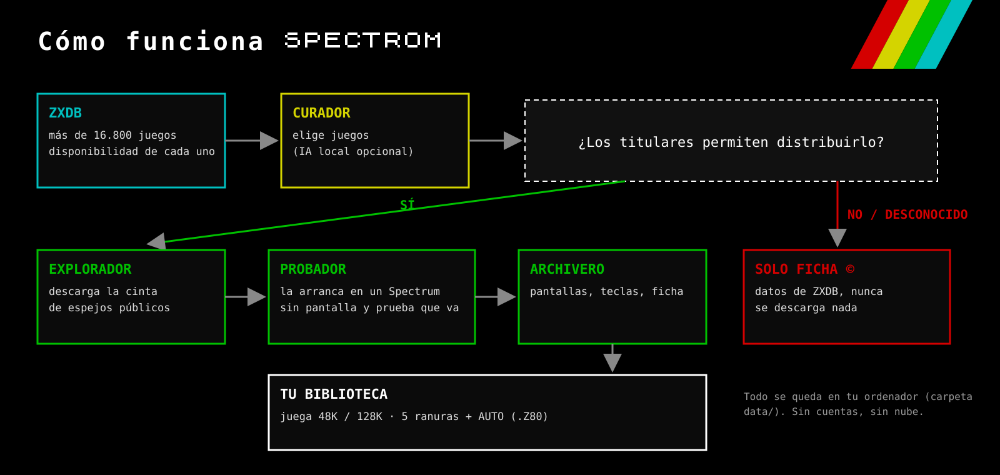
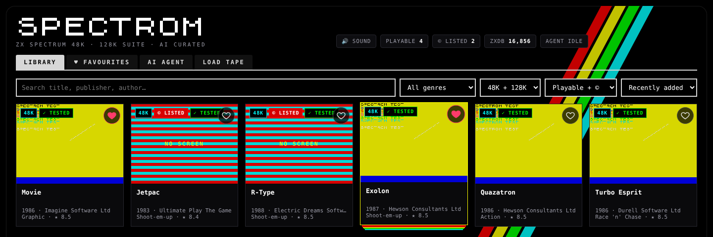
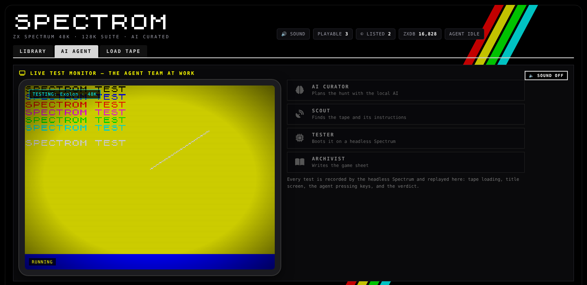
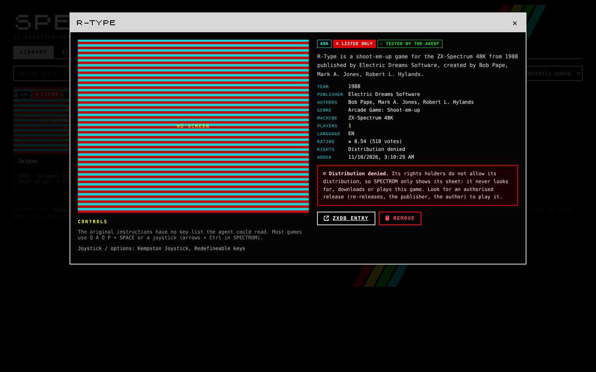
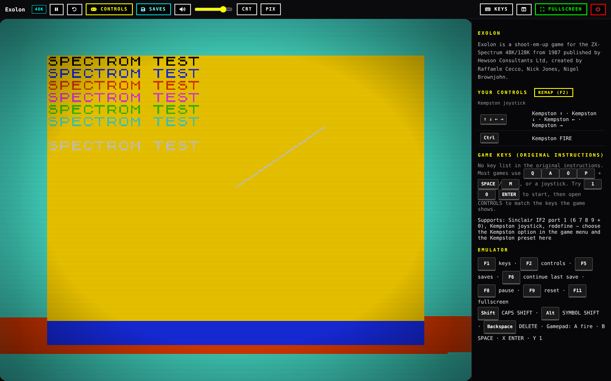
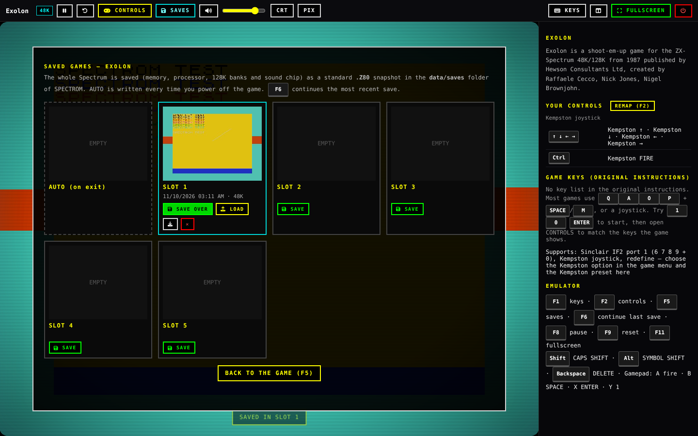

<h1></h1>

[English](README.md) · **Español**

SPECTROM es un emulador de ZX Spectrum 48K / 128K que funciona en tu navegador, con un pequeño equipo de agentes que monta tu
biblioteca de juegos por ti. Leen [ZXDB](https://github.com/zxdb/ZXDB) (la base de datos abierta del software de Spectrum),
descargan los juegos cuyos titulares permiten distribuirlos, arrancan cada uno en un Spectrum sin pantalla para comprobar que
de verdad carga y funciona, capturan sus pantallas, leen sus instrucciones originales para sacar las teclas y escriben una
ficha. Después lo juegas con un clic y guardas tu partida en 5 ranuras.

Es una única aplicación Node.js que se ejecuta en tu propio ordenador. Sin cuentas y sin nube: todo se guarda en la carpeta
`data/`.

Versión **1.0.2** · licencia **GPL-3.0-or-later** · ver [CHANGELOG.md](CHANGELOG.md)

## Índice

- [Solo juegos que se pueden distribuir](#solo-juegos-que-se-pueden-distribuir) · [Concepto](#concepto) · [Capturas](#capturas) · [Funciones](#funciones) · [Teclas durante el juego](#teclas-durante-el-juego)
- [Inicio rápido](#inicio-rápido)
- [Instalación paso a paso](#instalación-paso-a-paso): [qué necesitas](#1-qué-necesitas) · [Node.js](#2-instala-nodejs) · [descarga](#3-descarga-spectrom) · [instalar y arrancar](#4-instala-y-arranca) · [primera cacería](#5-ábrelo-y-haz-la-primera-cacería) · [parar y volver a arrancar](#6-páralo-y-vuelve-a-arrancarlo)
- [Guía de uso](#guía-de-uso): [biblioteca](#biblioteca) · [ficha del juego](#ficha-del-juego) · [agente IA](#pestaña-ai-agent) · [jugar](#jugar) · [controles](#controles-y-joysticks) · [partidas guardadas](#partidas-guardadas) · [cargar cinta](#pestaña-load-tape)
- [Opcional: IA local con Ollama](#opcional-ia-local-con-ollama)
- [En segundo plano o al encender el ordenador](#en-segundo-plano-o-al-encender-el-ordenador) · [Docker](#docker) · [Otros dispositivos de tu red](#usarlo-desde-otros-dispositivos-de-tu-red)
- [Ajustes](#ajustes) · [Carpeta de datos y copias](#carpeta-de-datos-y-copias-de-seguridad) · [Actualizar](#actualizar) · [Desinstalar](#desinstalar) · [Problemas y soluciones](#problemas-y-soluciones)
- [Tests](#tests) · [El núcleo del emulador](#el-núcleo-del-emulador) · [Licencia](#licencia)

## Solo juegos que se pueden distribuir

ZXDB indica, para cada título, si sus titulares permiten distribuirlo. SPECTROM sigue ese dato al pie de la letra:

| Disponibilidad en ZXDB | Qué hace SPECTROM |
|---|---|
| **Disponible** (los titulares permiten distribuirlo) | Descarga la cinta de espejos públicos, la prueba, la guarda y te deja jugarla. |
| **Distribución denegada**, denegada por un dueño posterior, desconocida, nunca publicado o con restricciones | **Solo ficha.** Muestra los datos de ZXDB (año, editora, autores, género, nota) marcados con ©. No se descarga nada de ese título: ni cinta, ni instrucciones, ni imágenes. No se puede jugar. |

Los enlaces que la propia ZXDB marca como denegados no se siguen nunca, y no hay ningún ajuste para cambiarlo.

**Cargar cinta** te deja abrir un `.tap`, `.tzx`, `.z80`, `.sna`, `.szx` o `.zip` de tu propio ordenador. Ese archivo no
sale de tu navegador y es responsabilidad tuya: carga solo archivos que tengas derecho a usar.

## Concepto



1. **CURADOR** elige juegos del índice de ZXDB (por nota, por género o con una petición como *"juegos de plataformas"*). Si
   tienes una IA local ([Ollama](https://ollama.com)) con RAM libre, planifica con ella; si no, usa reglas sencillas.
2. **EXPLORADOR** descarga la cinta de cada juego *disponible* de archivos públicos de Spectrum (Spectrum Computing, ZXInfo,
   World of Spectrum Classic, espejos de Internet Archive). Puedes activar o desactivar cada fuente.
3. **PROBADOR** carga la cinta en un Spectrum sin pantalla (el mismo núcleo del emulador, en Node.js), pulsa teclas y solo
   acepta el juego si de verdad llega a sus pantallas. Hasta dos capturas forman la portada.
4. **ARCHIVERO** escribe la ficha: descripción, controles y teclas (solo las que aparecen de verdad en las instrucciones
   originales), opciones de joystick e imágenes.

## Capturas

> Las capturas se hicieron con la cinta de prueba de los tests (`tests/mktap.mjs`), por eso las pantallas de juego muestran
> "SPECTROM TEST" en lugar de los juegos reales. La interfaz está en inglés.

**Biblioteca:** búsqueda, filtros (género, 48K/128K, jugable o ©) y fichas con el veredicto del agente.



**Agente IA:** monitor de pruebas en directo, los cuatro agentes, estado y registro.



**Un título ©:** solo ficha, sin botón LOAD.



**Jugando:** modos CRT y píxel, volumen, joystick Kempston, controles y las teclas originales junto a la pantalla.



**Partidas guardadas:** 5 ranuras más AUTO para cada juego.



## Funciones

- **Emulador**: [JSSpeccy 3](https://github.com/gasman/jsspeccy3) de Matt Westcott (WebAssembly), Spectrum 48K y 128K,
  sonido AY, carga rápida de cintas `.tap` / `.tzx`, snapshots `.z80`, `.sna` y `.szx`.
- **Controles**: teclado, joystick con las flechas + Ctrl (Kempston, Sinclair, Cursor o teclas del juego), mando (A disparo, B espacio, X enter, Y 1), teclas
  redefinibles y las teclas propias del juego sacadas de sus instrucciones.
- **Pantalla**: pantalla completa (F11), filtro CRT, píxeles nítidos, volumen y pausa.
- **Partidas guardadas**: la máquina entera (memoria, procesador, bancos de 128K y chip de sonido) como snapshot `.Z80` v3
  estándar. 5 ranuras por juego más **AUTO**, que se escribe cada vez que sales del juego. F5 abre las ranuras y F6 continúa
  la última partida. Cada ranura tiene miniatura y se puede descargar como `.z80`.
- **Agente**: cacerías bajo demanda con petición opcional, cacerías automáticas opcionales cada pocas horas, reintento de
  juegos fallidos, comprobación de fuentes y reconstrucción completa del índice de ZXDB (más de 16.800 juegos).
- **Ligero**: solo Node.js (sin base de datos, sin Python, sin paquetes del sistema). El índice de ZXDB se lee del volcado
  oficial con poca memoria.

## Teclas durante el juego

| Tecla | Acción |
|---|---|
| F1 | Ayuda: teclas del juego y tus controles |
| F2 | Controles (redefinir) |
| F5 | Partidas guardadas |
| F6 | Continuar la última partida |
| F8 | Pausa |
| F9 | Reset |
| F11 | Pantalla completa |
| Mayús / Alt | CAPS SHIFT / SYMBOL SHIFT |
| Retroceso | DELETE |
| Flechas + Ctrl | Joystick + disparo (lo que pulsan se elige en CONTROLS, F2) |

## Inicio rápido

```bash
git clone https://github.com/Plastikelectrik/spectrom-standalone.git
cd spectrom-standalone
npm install
npm start
```

Abre <http://127.0.0.1:8484>, ve a **AI AGENT** y pulsa **HUNT NOW**. La guía paso a paso de abajo explica cada paso.

## Instalación paso a paso

### 1. Qué necesitas

- Un ordenador con **Windows 10/11, macOS 12+ o Linux** (también funciona en una Raspberry Pi 4/5).
- **Node.js 18.17 o superior** (recomendado 20 o 22). Nada más: ni base de datos, ni Python, ni paquetes extra.
- Un navegador actual: Chrome, Edge, Firefox o Safari.
- Unos **150 MB** de disco para SPECTROM y el índice de ZXDB, y un poco más por juego (la mayoría de cintas pesan menos de 100 KB).
- Conexión a internet mientras el agente caza. Jugar a los juegos que ya están en tu biblioteca funciona sin conexión.

### 2. Instala Node.js

Comprueba si ya lo tienes: abre un terminal (en Windows: *PowerShell*) y escribe `node -v`. Si sale `v18.17` o superior, pasa
al paso 3.

- **Windows**: descarga el instalador **LTS** de <https://nodejs.org>, ejecútalo y acepta las opciones por defecto. Cierra y
  vuelve a abrir PowerShell. (O con winget: `winget install OpenJS.NodeJS.LTS`.)
- **macOS**: descarga el instalador **LTS** de <https://nodejs.org>, o con Homebrew: `brew install node`.
- **Linux (Debian/Ubuntu/Raspberry Pi OS)**:
  ```bash
  curl -fsSL https://deb.nodesource.com/setup_22.x | sudo -E bash -
  sudo apt-get install -y nodejs
  ```
  Otras distribuciones: mira <https://nodejs.org/en/download/package-manager>.

Vuelve a comprobarlo con `node -v` y `npm -v`.

### 3. Descarga SPECTROM

- **Con git** (recomendado, así actualizar es muy fácil):
  ```bash
  git clone https://github.com/Plastikelectrik/spectrom-standalone.git
  cd spectrom-standalone
  ```
  En Windows puedes instalar git desde <https://git-scm.com> (o `winget install Git.Git`).
- **Sin git**: en la página de GitHub pulsa **Code → Download ZIP**, descomprímelo y abre un terminal dentro de la carpeta
  `spectrom-standalone` (en Windows: clic derecho en la carpeta → *Abrir en Terminal*).

### 4. Instala y arranca

```bash
npm install
npm start
```

`npm install` descarga las dos pequeñas librerías que usa SPECTROM (Express y pako). `npm start` muestra:

```
SPECTROM standalone 1.0.2 — open http://127.0.0.1:8484  (data: …/spectrom-standalone/data)
```

Deja ese terminal abierto mientras usas SPECTROM: es el servidor.

### 5. Ábrelo y haz la primera cacería

1. Abre <http://127.0.0.1:8484> en tu navegador.
2. Pulsa la pestaña **AI AGENT** y luego **HUNT NOW** (10 juegos por defecto).
3. La primera cacería descarga el volcado de ZXDB (unos 27 MB) y crea el índice de más de 16.800 juegos. Tarda uno o dos
   minutos; el **Live log** muestra el progreso.
4. El **Live test monitor** reproduce cada prueba: la carga de la cinta, la pantalla de título y las teclas que pulsa el agente,
   con un sello ✓ WORKS o ✗ FAILED.
5. Vuelve a **LIBRARY**: allí están todos los juegos que han pasado la prueba. Pulsa uno y luego **LOAD ""**.

### 6. Páralo y vuelve a arrancarlo

- Para parar SPECTROM pulsa **Ctrl+C** en su terminal.
- Para arrancarlo otra vez, abre un terminal en la carpeta y ejecuta `npm start`. Tu biblioteca y tus partidas se guardan en `data/`.

## Guía de uso

La interfaz de SPECTROM está en inglés; aquí tienes qué hace cada parte.

### Biblioteca

- **Busca** por título, editora o autor, y filtra por **género**, **máquina** (48K o 128K) y **estado** (jugables, © solo ficha,
  pruebas fallidas). Ordena por fecha, popularidad, título o año.
- Cada ficha muestra la máquina, el veredicto del agente (✓ TESTED, © LISTED, FAILED) y la nota en ZXDB. Al pasar el ratón
  por encima se ve una segunda captura.
- Con la biblioteca vacía, el botón **Send the AI agent hunting** te lleva al agente.

### Ficha del juego

Pulsa una tarjeta para abrir su ficha:

- **Imágenes**: las pantallas capturadas en la prueba del agente, más la pantalla de carga, pantallas del juego y la carátula
  de los archivos cuando existen. Pulsa una miniatura para verla en grande.
- **Controles**: las teclas encontradas en las instrucciones originales, la tecla para empezar y los joysticks que admite.
- **Datos**: año, editora, autores, género, máquina, jugadores, idioma, nota, derechos, el resultado de la prueba y el origen del
  archivo.
- **Botones**: **LOAD ""** lo juega; **CONTINUE** (solo si lo guardaste antes) sigue tu última partida; **SEARCH AGAIN** (juegos
  fallidos) pide al agente que pruebe otra vez todas las fuentes; **ZXDB entry** abre su página en Spectrum Computing;
  **Remove** lo quita de tu biblioteca (archivos y ficha).
- Los títulos © muestran un aviso en lugar del botón LOAD: SPECTROM nunca los busca, descarga ni juega.

### Pestaña AI AGENT

- **Send it hunting**: escribe una petición opcional (*"space shooters"*, *"128K music games"*, *"Ultimate"*), elige cuántos
  juegos (de 1 a 50) y pulsa **HUNT NOW**. **STOP** para después del juego actual.
- **Search all of ZXDB**: busca cualquier título de Spectrum y pulsa **ADD** para que el agente descargue y pruebe ese juego.
  Los títulos sin archivo en ZXDB muestran **NO FILE**.
- **Game sources**: los archivos que usa el agente, en el orden en que los prueba. Desmarca una fuente para saltarla, **CHECK
  SOURCES** las comprueba todas y **SEARCH MISSING AGAIN** reintenta los juegos que no tenían copia. Esos juegos también se
  reintentan solos (a las 12 horas, 1 día, 2 días…).
- **Settings**: **caza automática** cada N horas con N juegos, el porcentaje de títulos © que se catalogan como ficha en cada
  cacería (0 % si no los quieres en la lista) y el de reintentos. **REBUILD ZXDB INDEX** descarga ZXDB otra vez (hazlo cada
  pocos meses para tener títulos nuevos; el índice también se renueva solo si tiene más de una semana cuando cazas).
- **Agent status** y **Live log** muestran qué hace el agente, la memoria y el disco libres, y cada paso.

### Jugar

Al empezar un juego, SPECTROM carga la cinta a toda velocidad y muestra la pantalla con su barra de herramientas:

| Botón | Qué hace |
|---|---|
| Pausa (F8) | Pausa / continuar |
| Reset (F9) | Reinicia el Spectrum |
| CONTROLS (F2) | Elegir y redefinir tus controles |
| SAVES (F5) | Las 5 ranuras + AUTO |
| Altavoz + barra | Silencio y volumen |
| CRT | Líneas de barrido y efecto de pantalla curva |
| PIX | Píxeles nítidos o suavizado |
| KEYS (F1) | Las teclas del juego y tus controles |
| Panel lateral | Muestra u oculta el panel con las teclas junto a la pantalla |
| FULLSCREEN (F11) | Pantalla completa |
| Encendido (rojo) | Apagar: guarda AUTO y vuelve a la biblioteca |

Letras, números, **ENTER** y **SPACE** funcionan como en el Spectrum. **Mayús** es CAPS SHIFT, **Alt** es SYMBOL SHIFT y
**Retroceso** es DELETE. El sonido empieza después de tu primer clic o tecla (es una norma de los navegadores).

### Controles y joysticks

Pulsa **CONTROLS (F2)** mientras juegas. Las flechas y **Ctrl** (disparo) hacen de joystick, y tú eliges qué joystick es:

| Opción | Teclas que recibe el Spectrum |
|---|---|
| From the game instructions | las teclas que el agente leyó en las instrucciones (por defecto cuando las hay) |
| Kempston joystick | puerto Kempston (elige también *Kempston* en el menú del juego) |
| Cursor joystick | 5 6 7 8 + 0 |
| Sinclair IF2 port 1 / port 2 | 6 7 8 9 + 0 / 1 2 3 4 + 5 |
| Q A O P + SPACE, Q A O P + M, Z X K M + SPACE | las distribuciones clásicas de teclado |
| Keyboard only | las flechas envían las teclas de cursor (CAPS SHIFT + 5 6 7 8) |

También puedes enviar **cualquier tecla de tu teclado a cualquier tecla del Spectrum o dirección del joystick**. Tu elección se
guarda para ese juego; **USE FOR ALL GAMES** la usa por defecto en todos. Un **mando** también funciona: el stick o la cruceta es
el joystick, **A** disparo, **B** SPACE, **X** ENTER, **Y** 1. Los controles se guardan en tu navegador (cada navegador tiene los
suyos).

### Partidas guardadas

- **F5** (o SAVES) abre las ranuras: **SAVE** guarda el Spectrum entero (memoria, procesador, bancos de 128K, chip de sonido) en
  una ranura, **LOAD** lo devuelve exactamente como estaba, el botón de descarga lo baja como archivo `.z80` estándar y ✕ lo borra.
- **AUTO** se guarda cada vez que apagas el juego (botón rojo de encendido).
- **F6** continúa al momento tu partida más reciente. La ficha del juego muestra **CONTINUE** cuando hay partida.
- Funciona con todos los juegos de tu biblioteca y con las cintas que cargues tú. Se guardan en `data/saves/<juego>/`.
- Los `.z80` descargados se abren en otros emuladores de Spectrum (Fuse, ZEsarUX, Spectaculator…).

### Pestaña LOAD TAPE

Arrastra un archivo `.tap`, `.tzx`, `.z80`, `.sna` o `.szx` (o un `.zip` que lo contenga) al recuadro, o pulsa **CHOOSE FILE**,
elige 48K o 128K y empieza. El archivo se queda en tu navegador: no se sube ni se añade a la biblioteca. Carga solo archivos que
tengas derecho a usar.

## Opcional: IA local con Ollama

SPECTROM funciona sin ninguna IA. Con [Ollama](https://ollama.com) en el mismo ordenador, el curador planifica las cacerías con
ella (entiende mejor peticiones como *"funny games for two players"*) y el archivero escribe fichas más completas.

1. Instala Ollama desde <https://ollama.com/download>.
2. Descarga un modelo pequeño: `ollama pull qwen2.5:1.5b` (alrededor de 1 GB; `llama3.2:3b` da mejores textos si tienes 8 GB de RAM).
3. Arranca SPECTROM como siempre. El agente usa el modelo cuando hay al menos ~1,8 GB de memoria libre y lo descarga al terminar
   la cacería; el **Live log** dice *AI curator: <modelo>* o *heuristic planner*.

Otro modelo u otra dirección: `SPECTROM_MODEL` y `SPECTROM_OLLAMA` en `.env` (ver [Ajustes](#ajustes)).

## En segundo plano o al encender el ordenador

Con **pm2** (Windows, macOS y Linux):

```bash
npm install -g pm2
pm2 start server.js --name spectrom
pm2 save
pm2 startup        # Linux/macOS: muestra un comando que debes ejecutar; después SPECTROM arranca con el ordenador
```

`pm2 logs spectrom` muestra su salida, `pm2 restart spectrom` lo reinicia y `pm2 delete spectrom` lo quita. En Windows usa
`npm install -g pm2-windows-startup` y `pm2-startup install` para que arranque con Windows.

## Docker

```bash
docker compose up -d          # construir y arrancar
docker compose logs -f        # ver la salida
docker compose down           # parar
```

La página se publica solo en `127.0.0.1:8484`, los datos viven en el volumen `spectrom-data` y el contenedor se reinicia solo.
Si Ollama está en el ordenador anfitrión, el archivo compose ya apunta el agente hacia él (`host.docker.internal:11434`).
Sin compose: `docker build -t spectrom . && docker run -d -p 127.0.0.1:8484:8484 -v spectrom-data:/app/data spectrom`.

## Usarlo desde otros dispositivos de tu red

SPECTROM **no tiene login**, así que por defecto solo responde en este ordenador. Para jugar desde una tablet u otro PC de casa:

1. En `.env` pon `HOST=0.0.0.0` (Docker: cambia la línea del puerto a `"8484:8484"`).
2. Reinicia SPECTROM y abre `http://<IP de este ordenador>:8484` en el otro dispositivo (la IP la ves con `ipconfig` en Windows o
   `ip addr` / `ifconfig` en Linux/macOS). Permite Node.js en el cortafuegos si te lo pregunta.

Hazlo solo en una red de confianza: cualquiera en ella puede usar SPECTROM, lanzar cacerías y borrar juegos. Nunca abras el
puerto a internet.

## Ajustes

Copia `.env.example` a `.env` (en la carpeta de SPECTROM), cambia lo que necesites y reinicia SPECTROM.

| Variable | Por defecto | Significado |
|---|---|---|
| `HOST` | `127.0.0.1` | Dirección de la página. SPECTROM **no tiene login**: déjalo en tu propio ordenador. |
| `PORT` | `8484` | Puerto de la página. |
| `SPECTROM_AGENT_PORT` | `8240` | Puerto interno del agente (solo escucha en 127.0.0.1). Cámbialo si 8240 está ocupado. |
| `SPECTROM_DATA` | `data` | Carpeta del catálogo, el índice de ZXDB, los juegos y tus partidas guardadas. |
| `SPECTROM_OLLAMA` | `http://127.0.0.1:11434` | Dirección de la IA local opcional. |
| `SPECTROM_MODEL` | (automático) | Modelo de Ollama a usar, p. ej. `qwen2.5:1.5b`. |
| `SPECTROM_ZXDB_URL` | ZXDB en GitHub | De dónde se descarga el volcado de ZXDB. |
| `SPECTROM_AGENT` | `on` | `off` sirve la página sin arrancar el agente. |

## Carpeta de datos y copias de seguridad

```
data/
├── zxdb/                  volcado de ZXDB y el índice compacto
├── catalog.json           las fichas de los juegos
├── games/<id>/            cinta e imágenes de cada juego jugable
├── saves/<id>/<ranura>.*  tus partidas (.z80 + miniatura + datos)
├── settings.json          ajustes del agente y fuentes activas
└── agent.log
```

- **Copia de seguridad** de tus partidas: copia `data/saves/`; copia toda la carpeta `data/` para guardar también la biblioteca.
- **Restaurar**: vuelve a poner la carpeta en su sitio (con SPECTROM parado).
- **Llevar SPECTROM a otro ordenador**: instálalo allí y copia `data/` en la carpeta nueva.
- Con Docker los datos están en el volumen `spectrom-data`:
  `docker run --rm -v spectrom-data:/d -v "$PWD":/b alpine tar czf /b/spectrom-data.tgz -C /d .`

## Actualizar

```bash
cd spectrom-standalone
git pull
npm install
npm start          # o: pm2 restart spectrom
```

Una actualización nunca toca tu carpeta `data/`. Si lo descargaste en ZIP, baja el ZIP nuevo, descomprímelo y copia dentro tu
carpeta `data/` antigua (y `.env`, si lo creaste). Con Docker: `git pull && docker compose up -d --build`.
La [página de versiones](https://github.com/Plastikelectrik/spectrom-standalone/releases) explica qué cambió en cada una.

## Desinstalar

Para SPECTROM (Ctrl+C, `pm2 delete spectrom` o `docker compose down -v`) y borra la carpeta `spectrom-standalone`. Todo lo que
guarda SPECTROM está dentro de esa carpeta (o en el volumen de Docker). Node.js puede quedarse o desinstalarse como cualquier
programa.

## Problemas y soluciones

| Problema | Solución |
|---|---|
| `node` no se reconoce / no se encuentra `npm` | Node.js no está instalado o el terminal estaba abierto antes de instalarlo: instálalo ([paso 2](#2-instala-nodejs)) y abre un terminal nuevo. |
| `Error: listen EADDRINUSE … 8484` | Otro programa usa ese puerto: pon `PORT=8585` (u otro libre) en `.env`. Si dice 8240, cambia `SPECTROM_AGENT_PORT`. |
| La etiqueta dice **AGENT OFFLINE** | El agente se reinicia solo en unos segundos; el terminal muestra por qué se paró. Comprueba que `SPECTROM_AGENT` no es `off`. |
| La primera cacería falla con *ZXDB … download* | Tu red bloquea GitHub. Descarga `ZXDB_mysql.sql.zip` de <https://github.com/zxdb/ZXDB> por otro medio, ponlo en `data/zxdb/` y caza otra vez: SPECTROM crea el índice con ese archivo. |
| Muchos juegos acaban en **FAILED** / *not found in any source* | Algún archivo está caído o rechaza peticiones: abre **Game sources**, pulsa **CHECK SOURCES** y más tarde **SEARCH MISSING AGAIN**. |
| *less than 3 GB free on disk* | El agente no caza con menos de 3 GB libres, para proteger tu disco. Libera espacio. |
| No hay sonido | Haz clic en la página o pulsa una tecla una vez (los navegadores solo activan el audio tras una acción tuya) y revisa la barra de volumen y el botón de silencio. |
| Pantalla negra o el juego no arranca | Usa un navegador actualizado con WebAssembly, recarga con Ctrl+F5 y prueba **Reset (F9)**. Algunos juegos necesitan 128K. |
| Las teclas no responden | Haz clic sobre la pantalla del Spectrum para darle el foco y mira **KEYS (F1)** para las teclas del juego y **CONTROLS (F2)** para el joystick. |
| El juego pide un joystick | Elige *Kempston* (o la opción que liste el juego) en su menú y la misma opción en **CONTROLS (F2)**. |
| Una partida no carga | Las partidas son del juego y la máquina con que se hicieron; la ranura muestra 48K/128K. Prueba **AUTO** o una ranura anterior. |
| No lo puedo abrir desde el móvil | Por defecto SPECTROM solo responde en este ordenador: mira [Otros dispositivos de tu red](#usarlo-desde-otros-dispositivos-de-tu-red). |
| Cualquier otra cosa | Mira el **Live log** de la pestaña AI AGENT y el terminal, y abre una incidencia en GitHub con esas líneas. |

## Tests

```bash
npm test
```

Los tests crean una cinta con un pequeño programa BASIC, comprueban que el probador la acepta y rechaza una rota, y hacen
un viaje de ida y vuelta `.Z80` (guardar → cargar → máquina idéntica) en 48K y 128K.

## El núcleo del emulador

`public/jsspeccy/` es una compilación de JSSpeccy 3.2.0 con un pequeño parche (`dev/jsspeccy-3.2.0-spectrom.patch`):
joystick Kempston, volumen, snapshots de la máquina entera para las ranuras y carga de archivos traídos por la página.
`public/jsspeccy/SOURCE.txt` explica cómo recompilar los mismos archivos desde el código original.

## Licencia

SPECTROM es software libre bajo la **GNU General Public License v3.0 o posterior** ([LICENSE](LICENSE)).
Las partes de terceros y sus licencias están en [NOTICE.md](NOTICE.md). Las ROM del ZX Spectrum son © Amstrad plc, que
permite distribuirlas para su uso con emuladores.

SPECTROM no está afiliado a Amstrad, Sky, ZXDB, Spectrum Computing ni a ninguno de los archivos que lee. Los nombres y
datos de los juegos proceden de ZXDB.
