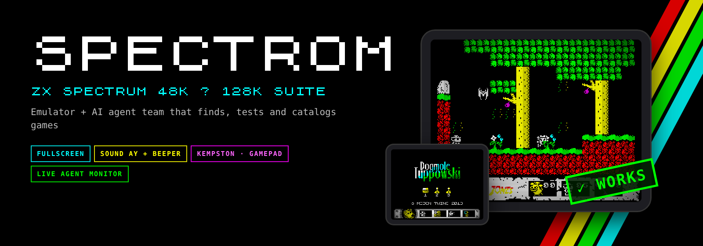
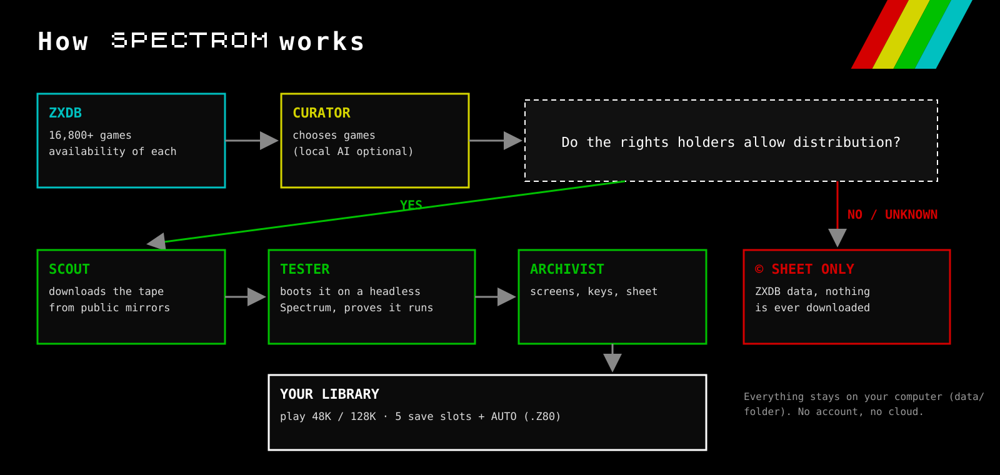
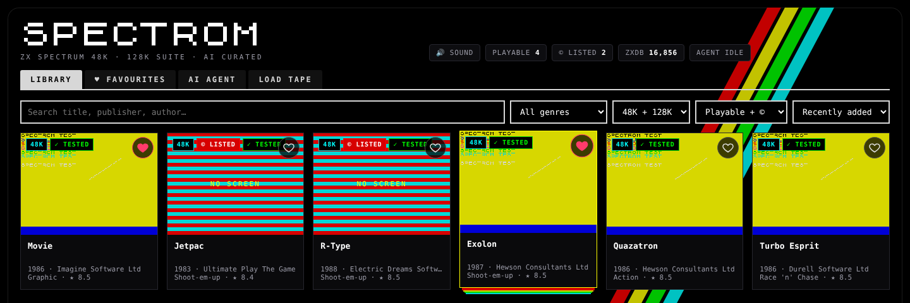
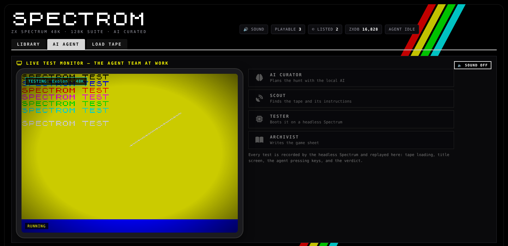
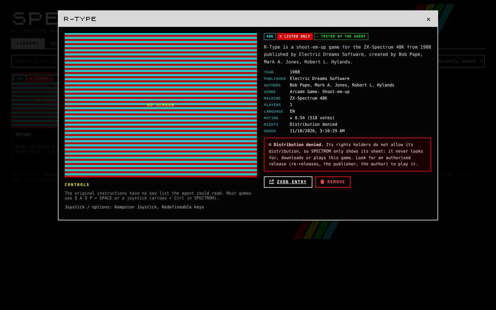
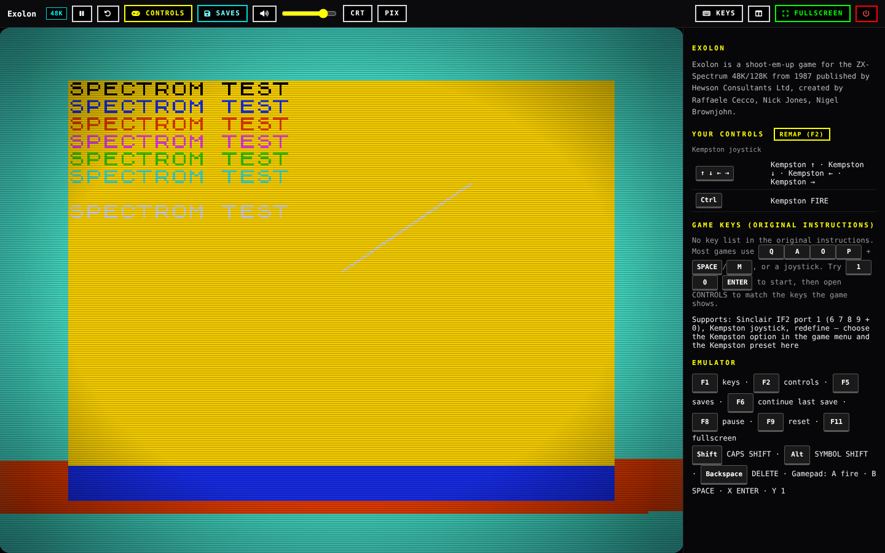
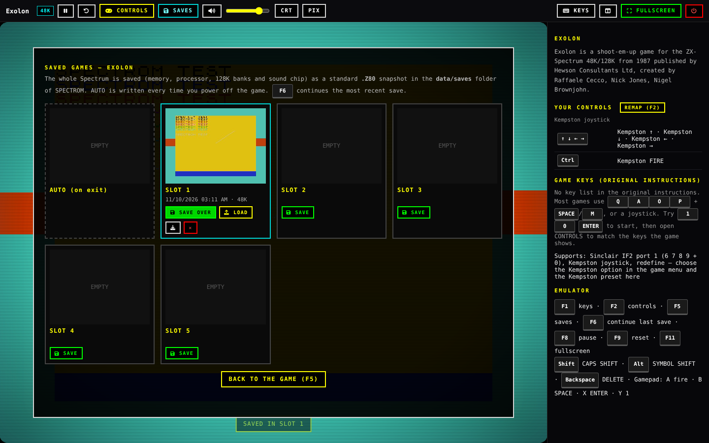

<h1></h1>

**English** · [Español](README.es.md)

SPECTROM is a ZX Spectrum 48K / 128K emulator that runs in your browser, with a small team of agents that build your game
library for you. They read [ZXDB](https://github.com/zxdb/ZXDB) (the open database of Spectrum software), download games whose
rights holders allow distribution, boot each one on a headless Spectrum to prove that it really loads and runs, capture its
screens, read its original instructions to find the keys, and write a game sheet. Then you play it with one click and save
your progress in 5 slots.

It is a single Node.js app that runs on your own computer. There are no accounts and no cloud: everything is kept in the
`data/` folder.

Version **1.0.2** · licence **GPL-3.0-or-later** · see [CHANGELOG.md](CHANGELOG.md)

## Contents

- [Only games that may be distributed](#only-games-that-may-be-distributed) · [Concept](#concept) · [Screenshots](#screenshots) · [Features](#features) · [Keys while playing](#keys-while-playing)
- [Quick start](#quick-start)
- [Step-by-step installation](#step-by-step-installation): [what you need](#1-what-you-need) · [Node.js](#2-install-nodejs) · [download](#3-download-spectrom) · [install and start](#4-install-and-start) · [first hunt](#5-open-it-and-run-the-first-hunt) · [stop and start again](#6-stop-it-and-start-it-again)
- [User guide](#user-guide): [library](#library) · [game sheet](#game-sheet) · [AI agent](#ai-agent-tab) · [playing](#playing) · [controls](#controls-and-joysticks) · [saved games](#saved-games) · [load tape](#load-tape-tab)
- [Optional: local AI with Ollama](#optional-local-ai-with-ollama)
- [Run it in the background or at start-up](#run-it-in-the-background-or-at-start-up) · [Docker](#docker) · [Other devices on your network](#use-it-from-other-devices-on-your-network)
- [Settings](#settings) · [Data folder and backups](#data-folder-and-backups) · [Update](#update) · [Uninstall](#uninstall) · [Troubleshooting](#troubleshooting)
- [Tests](#tests) · [The emulator core](#the-emulator-core) · [Licence](#licence)

## Only games that may be distributed

ZXDB records, for every title, whether its rights holders allow distribution. SPECTROM follows that record strictly:

| ZXDB availability | What SPECTROM does |
|---|---|
| **Available** (rights holders allow distribution) | Downloads the tape from public mirrors, tests it, keeps it and lets you play it. |
| **Distribution denied**, denied by a later owner, unknown, never released, or under restrictions | **Sheet only.** It shows the ZXDB data (year, publisher, authors, genre, rating) marked with ©. Nothing of the title is downloaded: no tape, no instructions, no images. It cannot be played. |

Links that ZXDB itself marks as denied are never followed, and there is no setting to turn this off.

**Load tape** lets you open a `.tap`, `.tzx`, `.z80`, `.sna`, `.szx` or `.zip` file from your own computer. That file never
leaves your browser and is your responsibility: only load files you have the right to use.

## Concept



1. **CURATOR** picks games from the ZXDB index (by rating, genre, or a request such as *"platform games"*). If you have a local
   AI ([Ollama](https://ollama.com)) running with spare RAM it plans with it; otherwise it uses simple rules.
2. **SCOUT** fetches the tape of each *available* game from public Spectrum archives (Spectrum Computing, ZXInfo, World of
   Spectrum Classic, Internet Archive mirrors). You can switch each source on or off.
3. **TESTER** loads the tape on a headless Spectrum (the same emulator core, running in Node.js), presses keys, and only accepts
   the game if it really reaches its screens. Up to two screenshots become the cover.
4. **ARCHIVIST** writes the sheet: description, controls and keys (only those that really appear in the original instructions),
   joystick options and images.

## Screenshots

> The screenshots were taken with the test tape bundled with the tests (`tests/mktap.mjs`), so the game screens show
> "SPECTROM TEST" instead of the real games.

**Library:** search, filters (genre, 48K/128K, playable or ©) and cards with the agent's verdict.



**AI agent:** live test monitor, the four agents, status and log.



**A © title:** sheet only, with no LOAD button.



**Playing:** CRT and pixel modes, volume, Kempston joystick, controls and the original keys next to the screen.



**Saved games:** 5 slots plus AUTO for each game.



## Features

- **Emulator**: [JSSpeccy 3](https://github.com/gasman/jsspeccy3) by Matt Westcott (WebAssembly), Spectrum 48K and 128K,
  AY sound, fast tape loading of `.tap` / `.tzx`, `.z80`, `.sna` and `.szx` snapshots.
- **Controls**: keyboard, joystick on the arrow keys + Ctrl (Kempston, Sinclair, Cursor or game keys), gamepad (A fire, B space, X enter, Y 1), redefinable
  keys, and the game's own keys read from its instructions.
- **Screen**: full screen (F11), CRT filter, sharp pixels, volume and pause.
- **Saved games**: the whole machine (memory, processor, 128K banks and sound chip) as a standard `.Z80` v3 snapshot.
  5 slots per game plus **AUTO**, which is written every time you leave the game. F5 opens the slots and F6 continues the most
  recent save. Each slot has a thumbnail and can be downloaded as `.z80`.
- **Agent**: on-demand hunts with an optional request, optional automatic hunts every few hours, retry of failed games,
  source checks, and a full rebuild of the ZXDB index (16,800+ games).
- **Light**: only Node.js (no database, no Python, no system packages). The ZXDB index is read from the official dump with low
  memory use.

## Keys while playing

| Key | Action |
|---|---|
| F1 | Help: the game's keys and your controls |
| F2 | Controls (remap) |
| F5 | Saved games |
| F6 | Continue the last save |
| F8 | Pause |
| F9 | Reset |
| F11 | Full screen |
| Shift / Alt | CAPS SHIFT / SYMBOL SHIFT |
| Backspace | DELETE |
| Arrows + Ctrl | Joystick + fire (what they press is chosen in CONTROLS, F2) |

## Quick start

```bash
git clone https://github.com/Plastikelectrik/spectrom-standalone.git
cd spectrom-standalone
npm install
npm start
```

Open <http://127.0.0.1:8484>, go to **AI AGENT** and press **HUNT NOW**. The step-by-step guide below explains every step.

## Step-by-step installation

### 1. What you need

- A computer with **Windows 10/11, macOS 12+ or Linux** (a Raspberry Pi 4/5 also works).
- **Node.js 18.17 or newer** (20 or 22 recommended). Nothing else: no database, no Python, no extra packages.
- A modern browser: Chrome, Edge, Firefox or Safari.
- About **150 MB** of disk for SPECTROM and the ZXDB index, plus a little for each game (most tapes are under 100 KB).
- An internet connection while the agent hunts. Playing the games already in your library works offline.

### 2. Install Node.js

Check whether you already have it: open a terminal (on Windows: *PowerShell*) and type `node -v`. If it prints `v18.17` or
higher, skip to step 3.

- **Windows**: download the **LTS** installer from <https://nodejs.org>, run it and accept the defaults. Close and open
  PowerShell again. (Or, with winget: `winget install OpenJS.NodeJS.LTS`.)
- **macOS**: download the **LTS** installer from <https://nodejs.org>, or with Homebrew: `brew install node`.
- **Linux (Debian/Ubuntu/Raspberry Pi OS)**:
  ```bash
  curl -fsSL https://deb.nodesource.com/setup_22.x | sudo -E bash -
  sudo apt-get install -y nodejs
  ```
  Other distributions: see <https://nodejs.org/en/download/package-manager>.

Check again with `node -v` and `npm -v`.

### 3. Download SPECTROM

- **With git** (recommended, makes updates easy):
  ```bash
  git clone https://github.com/Plastikelectrik/spectrom-standalone.git
  cd spectrom-standalone
  ```
  On Windows you can get git from <https://git-scm.com> (or `winget install Git.Git`).
- **Without git**: on the GitHub page press **Code → Download ZIP**, unzip it, and open a terminal inside the
  `spectrom-standalone` folder (on Windows: right-click the folder → *Open in Terminal*).

### 4. Install and start

```bash
npm install
npm start
```

`npm install` downloads the two small libraries SPECTROM uses (Express and pako). `npm start` prints:

```
SPECTROM standalone 1.0.2 — open http://127.0.0.1:8484  (data: …/spectrom-standalone/data)
```

Keep that terminal open while you use SPECTROM: it is the server.

### 5. Open it and run the first hunt

1. Open <http://127.0.0.1:8484> in your browser.
2. Click the **AI AGENT** tab and press **HUNT NOW** (10 games by default).
3. The first hunt downloads the ZXDB dump (about 27 MB) and builds the index of 16,800+ games. This takes one or two minutes;
   the **Live log** shows the progress.
4. The **Live test monitor** replays each test: the tape loading, the title screen and the keys the agent presses, with a
   ✓ WORKS or ✗ FAILED stamp.
5. Go back to **LIBRARY**: every game that passed its test is there. Click one and press **LOAD ""**.

### 6. Stop it and start it again

- To stop SPECTROM, press **Ctrl+C** in its terminal.
- To start it again, open a terminal in the folder and run `npm start`. Your library and saved games are kept in `data/`.

## User guide

### Library

- **Search** by title, publisher or author, and filter by **genre**, **machine** (48K or 128K) and **status** (playable,
  © listed, failed tests). Sort by date added, popularity, title or year.
- Each card shows the machine, the agent's verdict (✓ TESTED, © LISTED, FAILED) and the rating in ZXDB. Moving the mouse over
  a card shows a second screenshot.
- When the library is empty, the button **Send the AI agent hunting** takes you to the agent.

### Game sheet

Click a card to open its sheet:

- **Pictures**: the screens captured by the agent test, plus the loading screen, in-game screens and cassette inlay from the
  archives when they exist. Click a thumbnail to see it big.
- **Controls**: the keys found in the original instructions, the start key, and the joysticks the game supports.
- **Facts**: year, publisher, authors, genre, machine, players, language, rating, rights, the agent test result and the source
  of the file.
- **Buttons**: **LOAD ""** plays it; **CONTINUE** (only if you saved it before) resumes your last save; **SEARCH AGAIN**
  (failed games) asks the agent to try every source again; **ZXDB entry** opens its page on Spectrum Computing; **Remove**
  deletes it from your library (files and sheet).
- © titles show a note instead of the LOAD button: SPECTROM never looks for, downloads or plays them.

### AI agent tab

- **Send it hunting**: type an optional request (*"space shooters"*, *"128K music games"*, *"Ultimate"*), choose how many games
  (1 to 50) and press **HUNT NOW**. **STOP** stops after the current game.
- **Search all of ZXDB**: find any Spectrum title and press **ADD** to have the agent fetch and test that one game. Titles with
  no file in ZXDB show **NO FILE**.
- **Game sources**: the archives the agent uses, in the order it tries them. Untick a source to skip it, **CHECK SOURCES** tests
  them all, **SEARCH MISSING AGAIN** retries every game that had no copy. Games without a copy are also retried on their own
  (after 12 hours, 1 day, 2 days…).
- **Settings**: **auto hunt** every N hours with N games, the share of © titles catalogued as sheets in each hunt (0 % if you
  do not want them listed) and the share of retries. **REBUILD ZXDB INDEX** downloads ZXDB again (do it every few months to
  get new titles; the index is also refreshed by itself when it is older than a week and you hunt).
- **Agent status** and **Live log** show what the agent is doing, the free memory and disk, and every step.

### Playing

When a game starts, SPECTROM loads the tape at full speed and shows the screen with its tool bar:

| Button | What it does |
|---|---|
| Pause (F8) | Pause / resume |
| Reset (F9) | Reset the Spectrum |
| CONTROLS (F2) | Choose and remap your controls |
| SAVES (F5) | The 5 save slots + AUTO |
| Speaker + slider | Mute and volume |
| CRT | Scan lines and a curved glass look |
| PIX | Sharp pixels or smooth scaling |
| KEYS (F1) | The game's keys and your controls |
| Side panel | Show or hide the panel with the keys next to the screen |
| FULLSCREEN (F11) | Full screen |
| Power (red) | Power off: saves AUTO and goes back to the library |

Letters, numbers, **ENTER** and **SPACE** work as on the Spectrum. **Shift** is CAPS SHIFT, **Alt** is SYMBOL SHIFT and
**Backspace** is DELETE. The sound starts after your first click or key press (a browser rule).

### Controls and joysticks

Press **CONTROLS (F2)** while playing. The arrow keys and **Ctrl** (fire) act as a joystick, and you choose what that joystick
is:

| Preset | Keys sent to the Spectrum |
|---|---|
| From the game instructions | the keys the agent read in the instructions (default when there are any) |
| Kempston joystick | Kempston port (choose *Kempston* in the game's menu too) |
| Cursor joystick | 5 6 7 8 + 0 |
| Sinclair IF2 port 1 / port 2 | 6 7 8 9 + 0 / 1 2 3 4 + 5 |
| Q A O P + SPACE, Q A O P + M, Z X K M + SPACE | the classic keyboard layouts |
| Keyboard only | arrows send the cursor keys (CAPS SHIFT + 5 6 7 8) |

You can also send **any key of your keyboard to any Spectrum key or joystick direction**. Your choice is saved for that game;
**USE FOR ALL GAMES** makes it the default for every game. A **gamepad** works too: the stick or D-pad is the joystick, **A** fire,
**B** SPACE, **X** ENTER, **Y** 1. Controls are kept in your browser (each browser has its own).

### Saved games

- **F5** (or SAVES) opens the slots: **SAVE** writes the whole Spectrum (memory, processor, 128K banks, sound chip) into a slot,
  **LOAD** brings it back exactly as it was, the download button saves it as a standard `.z80` file, ✕ deletes it.
- **AUTO** is written every time you power off the game (red power button).
- **F6** continues your most recent save at once. The game sheet shows **CONTINUE** when there is a save.
- Saves work for every game of your library and for tapes you load yourself. They are kept in `data/saves/<game>/`.
- The downloaded `.z80` files open in other Spectrum emulators (Fuse, ZEsarUX, Spectaculator…).

### Load tape tab

Drop a `.tap`, `.tzx`, `.z80`, `.sna` or `.szx` file (or a `.zip` with one inside) on the box, or press **CHOOSE FILE**, pick
48K or 128K and it starts. The file stays in your browser: it is not uploaded or added to the library. Only load files you have
the right to use.

## Optional: local AI with Ollama

SPECTROM works without any AI. With [Ollama](https://ollama.com) running on the same computer, the curator plans the hunts
with it (it understands requests like *"funny games for two players"* better) and the archivist writes richer sheets.

1. Install Ollama from <https://ollama.com/download>.
2. Download a small model: `ollama pull qwen2.5:1.5b` (about 1 GB; `llama3.2:3b` gives better text if you have 8 GB of RAM).
3. Start SPECTROM as usual. The agent uses the model when there are at least ~1.8 GB of free memory and unloads it after the
   hunt; the **Live log** says *AI curator: <model>* or *heuristic planner*.

Other model or address: `SPECTROM_MODEL` and `SPECTROM_OLLAMA` in `.env` (see [Settings](#settings)).

## Run it in the background or at start-up

With **pm2** (Windows, macOS and Linux):

```bash
npm install -g pm2
pm2 start server.js --name spectrom
pm2 save
pm2 startup        # Linux/macOS: prints one command to run, then SPECTROM starts with the computer
```

`pm2 logs spectrom` shows its output, `pm2 restart spectrom` restarts it and `pm2 delete spectrom` removes it. On Windows,
use `npm install -g pm2-windows-startup` and `pm2-startup install` to start it with Windows.

## Docker

```bash
docker compose up -d          # build and start
docker compose logs -f        # see the output
docker compose down           # stop
```

The page is published on `127.0.0.1:8484` only, the data lives in the `spectrom-data` volume and the container restarts by
itself. If Ollama runs on the host, the compose file already points the agent to it (`host.docker.internal:11434`).
Without compose: `docker build -t spectrom . && docker run -d -p 127.0.0.1:8484:8484 -v spectrom-data:/app/data spectrom`.

## Use it from other devices on your network

SPECTROM has **no login**, so by default it only answers on this computer. To play from a tablet or another PC at home:

1. In `.env` set `HOST=0.0.0.0` (Docker: change the port line to `"8484:8484"`).
2. Restart SPECTROM and open `http://<this computer's IP>:8484` on the other device (find the IP with `ipconfig` on Windows or
   `ip addr` / `ifconfig` on Linux/macOS). Allow Node.js through the firewall if asked.

Only do this on a network you trust: anyone on it can use SPECTROM, start hunts and delete games. Never open the port to the
internet.

## Settings

Copy `.env.example` to `.env` (in the SPECTROM folder), change what you need and restart SPECTROM.

| Variable | Default | Meaning |
|---|---|---|
| `HOST` | `127.0.0.1` | Address of the web page. SPECTROM has **no login**: keep it on your own computer. |
| `PORT` | `8484` | Port of the web page. |
| `SPECTROM_AGENT_PORT` | `8240` | Internal port of the agent (listens on 127.0.0.1 only). Change it if 8240 is taken. |
| `SPECTROM_DATA` | `data` | Folder for the catalogue, the ZXDB index, the games and your saved games. |
| `SPECTROM_OLLAMA` | `http://127.0.0.1:11434` | Address of the optional local AI. |
| `SPECTROM_MODEL` | (automatic) | Ollama model to use, e.g. `qwen2.5:1.5b`. |
| `SPECTROM_ZXDB_URL` | ZXDB on GitHub | Where the ZXDB dump is downloaded from. |
| `SPECTROM_AGENT` | `on` | `off` serves the page without starting the agent. |

## Data folder and backups

```
data/
├── zxdb/                  ZXDB dump and the compact index
├── catalog.json           the game sheets
├── games/<id>/            tape and images of each playable game
├── saves/<id>/<slot>.*    your saved games (.z80 + thumbnail + info)
├── settings.json          agent settings and enabled sources
└── agent.log
```

- **Back up** your saved games by copying `data/saves/`; copy the whole `data/` folder to keep the library too.
- **Restore** by putting the folder back (with SPECTROM stopped).
- **Move SPECTROM** to another computer: install it there and copy `data/` into the new folder.
- With Docker the data is in the `spectrom-data` volume:
  `docker run --rm -v spectrom-data:/d -v "$PWD":/b alpine tar czf /b/spectrom-data.tgz -C /d .`

## Update

```bash
cd spectrom-standalone
git pull
npm install
npm start          # or: pm2 restart spectrom
```

Your `data/` folder is never touched by an update. With the ZIP download, download the new ZIP, unzip it and copy your old
`data/` folder (and `.env`, if you made one) into it. With Docker: `git pull && docker compose up -d --build`.
The [releases page](https://github.com/Plastikelectrik/spectrom-standalone/releases) lists what changed in each version.

## Uninstall

Stop SPECTROM (Ctrl+C, `pm2 delete spectrom` or `docker compose down -v`) and delete the `spectrom-standalone` folder.
Everything SPECTROM stores is inside that folder (or in the Docker volume). Node.js can stay or be uninstalled as usual.

## Troubleshooting

| Problem | Solution |
|---|---|
| `node` is not recognised / `npm` not found | Node.js is not installed or the terminal was open before installing it: install it ([step 2](#2-install-nodejs)) and open a new terminal. |
| `Error: listen EADDRINUSE … 8484` | Another program uses the port: set `PORT=8585` (or any free port) in `.env`. If it says 8240, change `SPECTROM_AGENT_PORT`. |
| The chip says **AGENT OFFLINE** | The agent restarts by itself in a few seconds; the terminal shows why it stopped. Check that `SPECTROM_AGENT` is not `off`. |
| The first hunt fails with *ZXDB … download* | Your network blocks GitHub. Download `ZXDB_mysql.sql.zip` from <https://github.com/zxdb/ZXDB> by other means, put it in `data/zxdb/` and hunt again: SPECTROM builds the index from that file. |
| Many games end as **FAILED** / *not found in any source* | An archive may be down or refusing requests: open **Game sources**, press **CHECK SOURCES** and later **SEARCH MISSING AGAIN**. |
| *less than 3 GB free on disk* | The agent does not hunt with less than 3 GB free, to protect your disk. Free some space. |
| No sound | Click on the page or press a key once (browsers only start audio after a user action) and check the volume slider and the mute button. |
| Black screen or the game does not start | Use an up-to-date browser with WebAssembly, reload the page with Ctrl+F5, and try **Reset (F9)**. Some games need 128K: choose a 128K copy or use the sheet's machine. |
| The keys do not respond | Click on the Spectrum screen to give it the focus, and look at **KEYS (F1)** for the game's keys and **CONTROLS (F2)** for the joystick preset. |
| The game asks for a joystick | Choose *Kempston* (or the option the game lists) in the game menu and the same preset in **CONTROLS (F2)**. |
| A saved game will not load | Saves belong to the game and machine they were made with; the slot shows 48K/128K. Try **AUTO** or an older slot. |
| I can't open it from my phone | By default SPECTROM only answers on this computer: see [Other devices on your network](#use-it-from-other-devices-on-your-network). |
| Anything else | Look at the **Live log** in the AI AGENT tab and at the terminal, and open an issue on GitHub with those lines. |

## Tests

```bash
npm test
```

The tests build a tape with a small BASIC program, check that the tester accepts it and rejects a broken one, and do a `.Z80`
round trip (save → load → identical machine) on 48K and 128K.

## The emulator core

`public/jsspeccy/` is a build of JSSpeccy 3.2.0 with a small patch (`dev/jsspeccy-3.2.0-spectrom.patch`): Kempston joystick,
volume, whole-machine snapshots for the save slots, and loading files fetched by the page. `public/jsspeccy/SOURCE.txt`
explains how to rebuild the same files from the upstream source.

## Licence

SPECTROM is free software under the **GNU General Public License v3.0 or later** ([LICENSE](LICENSE)).
Third-party parts and their licences are listed in [NOTICE.md](NOTICE.md). The ZX Spectrum ROMs are © Amstrad plc, who
allow their distribution for use with emulators.

SPECTROM is not affiliated with Amstrad, Sky, ZXDB, Spectrum Computing or any of the archives it reads. The game names and
data shown come from ZXDB.
